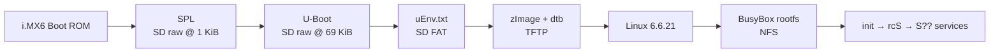

# Embedded Linux from Scratch on the UDOO Quad (NXP i.MX6Q)

A complete embedded Linux system **built and brought up by hand**, layer by layer, on real hardware:
bootloader → kernel → device tree → root filesystem → init system → networking → kernel modules.


-blue)


> I followed a BeagleBone Black (TI AM335x) embedded Linux course **on a different board** - the UDOO Quad
> (NXP i.MX6Q). Every board-specific step had to be understood and re-worked rather than copied:
> raw bootloader installation instead of files on FAT, i.MX SD controller numbering, console names, load addresses,
> a `uEnv.txt` loader the board does not have by default, and an NFS-safe init system.

<!-- Add a photo of the setup, then uncomment:

-->

---

## At a Glance

| Layer | What I used | Built how |
|---|---|---|
| Board | UDOO Quad - NXP i.MX6Q, 4x Cortex-A9 @ 1 GHz, 1 GB DDR3 | - |
| Host | Ubuntu 24.04 (x86-64) | - |
| Cross toolchain | `arm-linux-gnueabihf-` GCC 13.3.0 (Ubuntu 24.04 package), ARMv7 hard-float | `apt` |
| Bootloader | **U-Boot 2024.01** (mainline) - `SPL` + `u-boot.img` | `udoo_defconfig` |
| Kernel | **Linux 6.6.21** (LTS, mainline) - `zImage` | `imx_v6_v7_defconfig` |
| Device tree | `imx6q-udoo.dtb` | in-tree, `make dtbs` |
| Root filesystem | **BusyBox 1.38.0**, statically linked | `defconfig` + `CONFIG_STATIC=y` |
| Init system | BusyBox init + SysV-style `rcS`/`rcK` + `S??` service scripts | hand-written |
| Kernel modules | `g_ether` (USB Ethernet gadget) via `modprobe` | `modules_install` |
| Network boot | U-Boot TFTP (kernel + dtb), Linux NFS root | `tftpd-hpa`, `nfs-kernel-server` |
| Build system | **Buildroot 2026.08** (`mx6udoo_defconfig`) | in progress |

Versions checked on the build host:

```bash
$ arm-linux-gnueabihf-gcc --version | head -1
arm-linux-gnueabihf-gcc (Ubuntu 13.3.0-6ubuntu2~24.04.1) 13.3.0
$ file RFS_Static/bin/busybox
ELF 32-bit LSB executable, ARM, EABI5 version 1 (GNU/Linux), statically linked, for GNU/Linux 3.2.0, stripped
$ strings RFS_Static/bin/busybox | grep -m1 "BusyBox v"
BusyBox v1.38.0
```

### Result

```
power on → SPL → U-Boot → uEnv.txt → TFTP: zImage + dtb → Linux 6.6.21 → NFS root
        → init → rcS → S01logging → S02module (g_ether) → S40network (lo, usb0) → shell
```

Fully automatic, no key presses: the board boots its kernel from the laptop and mounts its root filesystem
from the laptop, so a rebuilt kernel or a changed file is live on the next reset - or instantly, for files.

---

## Table of Contents

1. [The Boot Chain](#1-the-boot-chain)
2. [Stage 1 - Host and Cross Toolchain](#stage-1---host-and-cross-toolchain)
3. [Stage 2 - U-Boot (SPL + U-Boot proper)](#stage-2---u-boot-spl--u-boot-proper)
4. [Stage 3 - SD Card Layout](#stage-3---sd-card-layout)
5. [Stage 4 - Linux Kernel and Device Tree](#stage-4---linux-kernel-and-device-tree)
6. [Stage 5 - Network Boot: TFTP and NFS](#stage-5---network-boot-tftp-and-nfs)
7. [Stage 6 - BusyBox Root Filesystem](#stage-6---busybox-root-filesystem)
8. [Stage 7 - Init System](#stage-7---init-system)
9. [Stage 8 - Kernel Modules and USB Gadget Networking](#stage-8---kernel-modules-and-usb-gadget-networking)
10. [Stage 9 - Automatic Boot with uEnv.txt](#stage-9---automatic-boot-with-uenvtxt)
11. [Stage 10 - Buildroot](#stage-10---buildroot)
12. [Problems I Solved](#problems-i-solved)
13. [Concepts Demonstrated](#concepts-demonstrated)
14. [BeagleBone → UDOO Port](#beaglebone--udoo-port)
15. [Repository Layout and Docs](#repository-layout-and-docs)

---

## 1. The Boot Chain



| Stage | Runs from | Job |
|---|---|---|
| Boot ROM | ROM inside the SoC | Reads SPL from a fixed raw offset of the SD card into on-chip RAM |
| SPL (~43 KB) | OCRAM (256 KB on-chip RAM) | Initialises the 1 GB DDR3, detects Quad vs Dual, loads U-Boot into DDR |
| U-Boot (~400 KB) | DDR | Drivers for SD, Ethernet, TFTP; loads kernel + dtb; passes `bootargs` |
| Kernel | DDR | Drivers from the device tree, mounts the root filesystem, starts `/sbin/init` |
| init | Root filesystem | `inittab` → `rcS` → services → shell |

**Why two bootloader stages:** at power-on the DDR controller is not configured, so only the small on-chip RAM is
usable. Full U-Boot does not fit there - SPL does, and its main job is to bring up DDR.

**Memory map used:**

| Region | Address |
|---|---|
| On-chip RAM (OCRAM) | `0x00900000` (256 KB) |
| DDR3 start | `0x10000000` |
| `uEnv.txt` load address | `0x11000000` |
| Kernel (`zImage`) | `0x12000000` |
| Device tree (`dtb`) | `0x18000000` |

---

## Stage 1 - Host and Cross Toolchain

The laptop is x86-64; the UDOO is 32-bit ARMv7 with a hardware FPU. Everything is **cross-compiled**.

```bash
sudo apt install build-essential gcc-arm-linux-gnueabihf bison flex bc libssl-dev \
    libncurses-dev libgnutls28-dev python3-setuptools python3-pyelftools swig \
    u-boot-tools picocom tftpd-hpa tftp-hpa nfs-kernel-server
```

| Prefix part | Meaning |
|---|---|
| `arm` | 32-bit ARM |
| `linux` | Target runs Linux (has a C library) - not bare-metal `none-eabi` |
| `gnueabihf` | GNU libc, ARM EABI, **hard-float** (FPU registers for float arguments) |

→ [docs/01-host-setup.md](docs/01-host-setup.md)

---

## Stage 2 - U-Boot (SPL + U-Boot proper)

```bash
cd u-boot-2024.01
make ARCH=arm CROSS_COMPILE=arm-linux-gnueabihf- udoo_defconfig
make ARCH=arm CROSS_COMPILE=arm-linux-gnueabihf- -j$(nproc)
ls -l SPL u-boot.img
```

```
-rw-rw-r-- 1 shaman shaman  44032 SPL
-rw-rw-r-- 1 shaman shaman 414316 u-boot.img
```

| File | Size | Role |
|---|---|---|
| `SPL` | 43 KB | First stage, contains the i.MX **IVT** header the Boot ROM looks for |
| `u-boot.img` | 405 KB | U-Boot proper with the header SPL needs to load it |

`u-boot.bin` is **not** used - it has no header, so SPL cannot load it.

**Proof - serial console (`picocom -b 115200 /dev/ttyUSB0`, onboard CP2104):**

```
U-Boot SPL 2024.01 ...
Trying to boot from MMC1

U-Boot 2024.01 ...
CPU:   Freescale i.MX6Q ...
Board: Udoo Quad
=>
```

→ [docs/02-u-boot.md](docs/02-u-boot.md)

---

## Stage 3 - SD Card Layout

The i.MX6 Boot ROM **cannot read a filesystem**. It reads raw sectors, looking for the IVT at offset `0x400`.
So the bootloader is written with `dd` to fixed offsets, and the partitions start after it.

```
Offset   0      1 KiB          69 KiB                    4 MiB           204 MiB
         | MBR | SPL ...       | u-boot.img ... (free)   | FAT32 "BOOT"  | ext4 "ROOTFS" ...
         |<----------- raw area: Boot ROM / SPL --------->|  partition 1  |  partition 2
```

```bash
sudo dd if=/dev/zero of=/dev/sda bs=1M count=10 conv=fsync

sudo sfdisk /dev/sda << EOF
label: dos
start=8192, size=200M, type=c, bootable
start=417792, type=83
EOF

sudo mkfs.vfat -F 32 -n BOOT /dev/sda1
sudo mkfs.ext4 -L ROOTFS /dev/sda2

sudo dd if=SPL        of=/dev/sda bs=1k seek=1  conv=fsync
sudo dd if=u-boot.img of=/dev/sda bs=1k seek=69 conv=fsync
```

| Value | Why |
|---|---|
| `start=8192` | Partition 1 at 4 MiB - keeps filesystems away from the bootloader area |
| `start=417792` | Partition 2 explicitly after partition 1 (without it, `sfdisk` filled the gap *inside* the U-Boot area) |
| `seek=1` (KiB) | Boot ROM reads the IVT at `0x400`; the first KiB keeps the MBR |
| `seek=69` (KiB) | `CONFIG_SYS_MMCSD_RAW_MODE_U_BOOT_SECTOR=0x8a` → 138 × 512 B = 69 KiB |

| Laptop | U-Boot |
|---|---|
| `/dev/sda` | `mmc 2` - the UDOO's slot is on uSDHC3 |
| `/dev/sda1` (FAT) | `mmc 2:1` |
| `/dev/sda2` (ext4) | `mmc 2:2` |

---

## Stage 4 - Linux Kernel and Device Tree

```bash
cd linux-6.6.21
make ARCH=arm CROSS_COMPILE=arm-linux-gnueabihf- imx_v6_v7_defconfig
make ARCH=arm CROSS_COMPILE=arm-linux-gnueabihf- -j$(nproc) zImage dtbs modules
```

| Output | Size | What it is |
|---|---|---|
| `arch/arm/boot/zImage` | 9.0 MB | Self-decompressing kernel |
| `arch/arm/boot/dts/nxp/imx/imx6q-udoo.dtb` | 36 KB | Compiled device tree (path changed in kernel 6.5) |

- **One kernel, many boards:** `imx_v6_v7_defconfig` builds a generic i.MX kernel; the **device tree** makes it fit the UDOO.
- **zImage + `bootz`** instead of the course's uImage + `bootm`: modern U-Boot boots a zImage directly - no `mkimage` header needed.

**Proof - first kernel boot without a root filesystem (the expected result):**

```
=> tftp 0x12000000 udoo/zImage
=> tftp 0x18000000 udoo/imx6q-udoo.dtb
=> setenv bootargs console=ttymxc1,115200
=> bootz 0x12000000 - 0x18000000
...
Kernel panic - not syncing: VFS: Unable to mount root fs on unknown-block(0,0)
```

This panic proves the bootloader, kernel, device tree and console all work - only the root filesystem was missing.

→ [docs/03-kernel.md](docs/03-kernel.md)

---

## Stage 5 - Network Boot: TFTP and NFS

```
  +------------------------+   Ethernet  192.168.7.x    +------------------+
  |  Laptop (Ubuntu)       |----------------------------| eth0  .2         |
  |  enp4s0  192.168.7.1   |   USB OTG   192.168.6.x    |   UDOO Quad      |
  |  TFTP: /tftpboot/udoo  |----------------------------| usb0  .2         |
  |  NFS:  /srv/nfs/udoo   |   USB serial (CP2104)      |                  |
  |  /dev/ttyUSB0          |----------------------------| ttymxc1          |
  +------------------------+                            +------------------+
```

| | TFTP | NFS |
|---|---|---|
| Used by | U-Boot | Linux kernel |
| Transfers | Single files into RAM (`zImage`, `dtb`) | A whole folder, mounted as `/` |
| Benefit | New kernel = copy one file and reset | Edit a file on the laptop - the board sees it instantly |

```bash
# Laptop: static IP on the direct Ethernet link
sudo nmcli con add type ethernet ifname enp4s0 con-name udoo-link \
    ipv4.method manual ipv4.addresses 192.168.7.1/24

# TFTP: kernel + dtb (own subfolder - /tftpboot also holds Zynq/PetaLinux files)
sudo cp zImage imx6q-udoo.dtb /tftpboot/udoo/
sudo chmod 755 /tftpboot/udoo && sudo chmod 644 /tftpboot/udoo/*

# NFS: export the root filesystem
echo "/srv/nfs/udoo 192.168.7.0/24(rw,sync,no_root_squash,no_subtree_check)" | sudo tee -a /etc/exports
sudo exportfs -ra
```

**Kernel command line:**

```
console=ttymxc1,115200 root=/dev/nfs rw nfsroot=192.168.7.1:/srv/nfs/udoo,v3,tcp
ip=192.168.7.2:192.168.7.1:192.168.7.1:255.255.255.0:udoo:eth0:off
```

| Part | Meaning |
|---|---|
| `console=ttymxc1,115200` | Kernel console on UART2 (the onboard USB-serial) |
| `root=/dev/nfs rw` | Root filesystem over NFS |
| `nfsroot=...,v3,tcp` | Server and folder; **NFS v3** - Ubuntu 24.04 has v2 disabled |
| `ip=client:server:gw:mask:hostname:iface:off` | Kernel-level IP config - U-Boot's `ipaddr` is not passed to Linux |

→ [docs/04-network-boot.md](docs/04-network-boot.md)

---

## Stage 6 - BusyBox Root Filesystem

```bash
cd busybox-1.38.0
make ARCH=arm CROSS_COMPILE=arm-linux-gnueabihf- defconfig
sed -i 's/# CONFIG_STATIC is not set/CONFIG_STATIC=y/' .config      # no shared libraries needed
sed -i 's/CONFIG_TC=y/# CONFIG_TC is not set/' .config              # fails with Ubuntu 24.04 headers
make ARCH=arm CROSS_COMPILE=arm-linux-gnueabihf- -j$(nproc)
make ARCH=arm CROSS_COMPILE=arm-linux-gnueabihf- CONFIG_PREFIX=~/Udoo_Workspace/RFS_Static install
```

```bash
file RFS_Static/bin/busybox
# ELF 32-bit LSB executable, ARM, EABI5 version 1 (GNU/Linux), statically linked, ... stripped
```

`make install` creates only `bin sbin usr linuxrc` - one binary plus hundreds of symlinks (`/bin/ls → busybox`).
A working root filesystem also needs:

| Added | Purpose |
|---|---|
| `dev proc sys tmp` | Mount points: device files, process info, kernel info, RAM temp files |
| `var/run var/log run` | PID files, `ifup` state, logs |
| `etc/inittab`, `etc/init.d/` | Init system (Stage 7) |
| `etc/network/interfaces` | Network config |
| `lib/modules/6.6.21/` | Kernel modules + `modules.dep` (Stage 8) |

**Static vs dynamic** - both built (`RFS_Static`, `RFS_Dynamic`):

| | Static | Dynamic |
|---|---|---|
| C library | Inside the binary | `ld-linux-armhf.so.3`, `libc.so.6`, `libm.so.6`... copied into `/lib` |
| Size | One larger binary | Smaller binaries, shared libraries |
| Portability | Runs on any ARMv7 hard-float Linux | Needs matching libraries |

**The root filesystem depends on the CPU architecture and ABI, not on the board** - the same BusyBox runs on the
BeagleBone and the UDOO. Board-specific parts are small: console name, kernel modules, firmware.

**Proof:**

```
~ # uname -a
Linux udoo 6.6.21 #1 SMP Sat Oct 10 19:27:42 +0530 2026 armv7l GNU/Linux
~ # cat /proc/cpuinfo
processor       : 3
model name      : ARMv7 Processor rev 10 (v7l)
Features        : half thumb fastmult vfp edsp neon vfpv3 tls vfpd32
CPU part        : 0xc09
Hardware        : Freescale i.MX6 Quad/DualLite (Device Tree)
```

Four processors, `CPU part 0xc09` = Cortex-A9.

→ [docs/05-busybox-rootfs.md](docs/05-busybox-rootfs.md)

---

## Stage 7 - Init System

```
Kernel → /sbin/init (PID 1) → /etc/inittab
            ::sysinit  → /etc/init.d/rcS
                           ├── mount proc, sysfs, devtmpfs, devpts, tmpfs
                           ├── mkdir /var/run /var/log /run
                           └── for S??* in order:  S01logging → S02module → S40network   (start)
            ::askfirst → /bin/sh on the console
            ::shutdown → /etc/init.d/rcK  (same scripts, reverse order, "stop")
```

| File | Job |
|---|---|
| [`inittab`](rootfs/overlay/etc/inittab) | **What** to run at boot/shutdown; empty console field = console from `bootargs` |
| [`rcS`](rootfs/overlay/etc/init.d/rcS) / [`rcK`](rootfs/overlay/etc/init.d/rcK) | **Order** - start / stop every `S??` script |
| [`S01logging`](rootfs/overlay/etc/init.d/S01logging) | `syslogd` + `klogd` via `start-stop-daemon` |
| [`S02module`](rootfs/overlay/etc/init.d/S02module) | `modprobe g_ether` with fixed MACs |
| [`S40network`](rootfs/overlay/etc/init.d/S40network) | `ifup -a` from [`/etc/network/interfaces`](rootfs/overlay/etc/network/interfaces) |

These are the course's Buildroot-style scripts; every change I made for the UDOO is marked `# UDOO:`.
The important one - **an NFS root changes the rules**:

| UDOO change | Why |
|---|---|
| `rcS` creates `/var/run`, `/var/log` | `ifup` died writing its state file → every later interface silently never started |
| `S40network` removes `/var/run/ifstate` | On NFS the state file **survives reboots** → `ifup` thought interfaces were already up |
| `S40network` flushes `lo` first | The kernel already set `127.0.0.1` from `ip=` → `RTNETLINK answers: File exists` |
| `eth0` is **not** `auto` in `interfaces` | `ifdown -a` at shutdown would take down the interface carrying the root filesystem |

**Proof - boot log and running services:**

```
Mounting proc
Mounting sysfs, devtmpfs, devpts, tmpfs
Starting logging: OK
Loading kernel modules : OK
Starting network: OK
...
~ # ps
  116 0   0:00 /sbin/syslogd -n
  119 0   0:00 /sbin/klogd -n
```

Low PIDs show the daemons were started by `rcS` during boot, not by hand.

→ [docs/06-init-system.md](docs/06-init-system.md)

---

## Stage 8 - Kernel Modules and USB Gadget Networking

```bash
sudo make ARCH=arm CROSS_COMPILE=arm-linux-gnueabihf- INSTALL_MOD_PATH=/srv/nfs/udoo modules_install
```

`modules_install` copies the `.ko` files **and** generates `modules.dep`, which `modprobe` uses to load a module's
dependencies first (`libcomposite`, `u_ether`, `usb_f_ecm`...). `insmod` loads one file and knows nothing about
dependencies.

With `g_ether` the UDOO acts as a **USB network adapter** on its OTG port - a second link to the laptop:

```
using host ethernet address: 02:00:00:00:06:01
using self ethernet address: 02:00:00:00:06:02
g_ether gadget.0: g_ether ready

~ # lsmod
g_ether 12288 0 - Live 0xbf000000
~ # ifconfig usb0
usb0  HWaddr 02:00:00:00:06:02
      inet addr:192.168.6.2  Mask:255.255.255.0
      UP BROADCAST RUNNING MULTICAST
```

**Fixed MAC addresses** (`dev_addr`, `host_addr`): by default `g_ether` picks random MACs, and Ubuntu names USB
network interfaces `enx` + MAC - so the laptop's interface name changed at every boot. Now it is always
`enx020000000601`.

→ [docs/07-usb-gadget-network.md](docs/07-usb-gadget-network.md)

---

## Stage 9 - Automatic Boot with uEnv.txt

The BeagleBone's U-Boot loads `uEnv.txt` automatically; the UDOO's does not. So I set `bootcmd` once:

```
=> mmc list
FSL_SDHC: 2 (SD)
=> ls mmc 2:1
      355   uEnv.txt
=> setenv bootcmd 'fatload mmc 2:1 0x11000000 uEnv.txt; env import -t 0x11000000 ${filesize}; run uenvcmd'
=> saveenv
```

[`boot/uEnv.txt`](boot/uEnv.txt):

```
ipaddr=192.168.7.2
serverip=192.168.7.1
kernel_addr=0x12000000
fdt_addr=0x18000000
bootargs=console=ttymxc1,115200 root=/dev/nfs rw nfsroot=192.168.7.1:/srv/nfs/udoo,v3,tcp ip=192.168.7.2:192.168.7.1:192.168.7.1:255.255.255.0:udoo:eth0:off
uenvcmd=tftp ${kernel_addr} udoo/zImage; tftp ${fdt_addr} udoo/imx6q-udoo.dtb; bootz ${kernel_addr} - ${fdt_addr}
```

| Part | Meaning |
|---|---|
| `fatload mmc 2:1 ...` | Read the text file from the FAT partition into RAM |
| `env import -t` | Turn every `name=value` line into a U-Boot variable |
| `run uenvcmd` | Execute the boot commands |
| Single quotes | Delay `${filesize}` expansion until boot time |

→ [boot/README.md](boot/README.md)

---

## Stage 10 - Buildroot

After building every layer by hand, the same system can be generated by **Buildroot** from one configuration.

| Item | Value |
|---|---|
| Buildroot | 2026.08, one shared source tree for all boards (`O=` output folder per board) |
| Board config | `mx6udoo_defconfig` (UDOO Quad/Dual) |
| Toolchain | External: Arm GNU Toolchain 15.2.Rel1 (`arm-none-linux-gnueabihf`) |
| Login console | getty on `ttymxc1` |
| Output used | `rootfs.tar` extracted into the NFS root; Buildroot's own `zImage` + dtb over TFTP |

Lessons:

- The kernel and the root filesystem must come from the **same build** - kernel modules in `/lib/modules/<version>`
  belong to one kernel, so Buildroot's rootfs needs Buildroot's kernel.
- A Buildroot image contains only what is selected: `ssh: Connection refused` meant no SSH server
  (Dropbear) and no root password were configured.
- Changing the toolchain or target options requires a full rebuild (`make clean all`).

The same Buildroot workflow is completed end-to-end on a Raspberry Pi 3 B+ (SSH, SFTP, Eclipse cross-development)
in the companion repository **rpi3-embedded-linux**.

---

## Problems I Solved

Each one is written up as symptom → cause → fix → lesson in [docs/troubleshooting.md](docs/troubleshooting.md).

| Symptom | Root cause |
|---|---|
| BeagleBone method (MLO + u-boot.img on FAT) does not boot | i.MX6 Boot ROM reads raw sectors, not files |
| `sfdisk` put partition 2 *before* partition 1 | No explicit `start=` → filled the free gap inside the U-Boot area |
| `Bad device specification mmc 0` | UDOO SD slot is on uSDHC3 → `mmc 2` |
| TFTP `Permission denied` | Folder missing the `x` (enter) bit - found with `namei -l` |
| NFS root hangs | Ubuntu 24.04 disabled NFS v2 → `nfsroot=...,v3` |
| `ifup: can't open '/var/run/ifstate.new'` | Missing `/var/run` stopped `ifup` before `usb0` |
| Interfaces skipped after reboot | Stale `ifstate` survives reboots on an NFS root |
| `lsmod` empty / `modprobe` cannot find `g_ether` | Modules copied by hand → no `modules.dep`; fixed with `modules_install` |
| Laptop interface name changed every boot | Random `g_ether` MACs → fixed `dev_addr`/`host_addr` |
| Ping over `usb0` failed although `RUNNING` | Rising RX / low TX counters → laptop side had no IP (DHCP requests) |
| No login prompt with BeagleBone files | Console `ttyO0` vs `ttymxc1` |

**Debugging approach:** find the last stage that succeeded, test each layer alone (ping before TFTP, a local TFTP get
before the board, a kernel panic before NFS), and read the exact error.

---

## Concepts Demonstrated

| Area | Concepts |
|---|---|
| **Boot process** | Boot ROM, IVT, SPL vs U-Boot proper, DDR initialisation, OCRAM, raw vs filesystem boot |
| **U-Boot** | defconfigs, environment, `setenv`/`saveenv`, `bootcmd`, `env import`, `fatload`, `tftp`, `bootz`, device numbering |
| **Kernel** | Cross-compiling, defconfigs, zImage vs uImage, command line (`console=`, `root=`, `nfsroot=`, `ip=`) |
| **Device tree** | Generic kernel + board dtb, dtb location in 6.5+ kernels |
| **Root filesystem** | BusyBox, static vs dynamic linking, required directories, architecture/ABI dependence |
| **Init** | inittab, sysinit/askfirst/shutdown, rcS/rcK, ordered `S??` services, `start-stop-daemon`, syslog |
| **Kernel modules** | `modules_install`, `modules.dep`, `modprobe` vs `insmod`, module parameters |
| **Networking** | Static host config, TFTP, NFS exports and versions, kernel IP autoconfig, ifupdown, USB gadget |
| **Linux host** | Partitioning, raw block devices, permissions, systemd services, NetworkManager |
| **Build systems** | Hand-built stack vs Buildroot, external toolchains, shared source with per-board output |
| **Debugging** | Serial console, layer-by-layer isolation, reading kernel and service logs |

---

## BeagleBone → UDOO Port

| Item | BeagleBone Black (course) | UDOO Quad (this project) |
|---|---|---|
| SoC | TI AM335x, 1x Cortex-A8 | NXP i.MX6Q, 4x Cortex-A9 |
| First stage | `MLO` file on FAT | `SPL` raw at 1 KiB |
| U-Boot install | File on FAT | Raw at 69 KiB |
| U-Boot / kernel config | `am335x_evm` / `omap2plus` | `udoo` / `imx_v6_v7` |
| Device tree | `am335x-boneblack.dtb` | `imx6q-udoo.dtb` |
| Console | `ttyS0` (`ttyO0`) | `ttymxc1` |
| SD in U-Boot | `mmc 0` | `mmc 2` |
| `uEnv.txt` | Loaded automatically | `bootcmd` set once |
| Kernel boot | uImage + `bootm` | zImage + `bootz` |
| RAM start / load addresses | `0x80000000` / `0x82000000` | `0x10000000` / `0x12000000` |
| Toolchain, BusyBox | `arm-linux-gnueabihf` | **same** - architecture-level, not board-level |

Full table with the reason for each difference: [docs/bbb-vs-udoo.md](docs/bbb-vs-udoo.md)

---

## Repository Layout and Docs

```
├── docs/             one chapter per stage + troubleshooting, porting cheat sheet, learning journal
├── scripts/          build-uboot.sh, build-kernel.sh, build-busybox.sh, flash-sd.sh,
│                     deploy-tftp.sh, setup-nfs-rootfs.sh, save-configs.sh (settings in config.sh)
├── boot/             uEnv.txt
├── rootfs/overlay/   inittab, init scripts, network/interfaces
├── host/             laptop configs: NFS exports, TFTP, network links
├── configs/          saved U-Boot / kernel / BusyBox configurations
├── apps/             cross-compiled C applications
├── dts/  patches/    custom device trees and source patches (next steps)
└── logs/  images/    serial boot logs and photos
```

| Chapter | Topic |
|---|---|
| [00-boot-process](docs/00-boot-process.md) | Boot ROM, SPL, SD layout, what the kernel needs |
| [01-host-setup](docs/01-host-setup.md) | Toolchain and host packages |
| [02-u-boot](docs/02-u-boot.md) | Build, SD card, serial console, U-Boot commands |
| [03-kernel](docs/03-kernel.md) | Kernel, device tree, modules |
| [04-network-boot](docs/04-network-boot.md) | TFTP, NFS, bootargs, uEnv.txt |
| [05-busybox-rootfs](docs/05-busybox-rootfs.md) | BusyBox and the root filesystem |
| [06-init-system](docs/06-init-system.md) | inittab, rcS/rcK, services |
| [07-usb-gadget-network](docs/07-usb-gadget-network.md) | g_ether and usb0 |
| [troubleshooting](docs/troubleshooting.md) | Every real problem and its fix |
| [bbb-vs-udoo](docs/bbb-vs-udoo.md) | Porting cheat sheet |
| [journal](docs/journal.md) | Learning log |

### Rebuild it

```bash
./scripts/build-uboot.sh
./scripts/build-kernel.sh
./scripts/build-busybox.sh
./scripts/flash-sd.sh /dev/sdX          # check the device with lsblk first
./scripts/deploy-tftp.sh
./scripts/setup-nfs-rootfs.sh
```

Source trees and build outputs are not committed - the scripts download and rebuild them.

---

## References

- U-Boot: <https://docs.u-boot.org/> · UDOO board notes: <https://docs.u-boot.org/en/latest/board/udoo/udoo.html>
- Linux NFS root: <https://docs.kernel.org/admin-guide/nfs/nfsroot.html>
- Kernel parameters: <https://docs.kernel.org/admin-guide/kernel-parameters.html>
- BusyBox: <https://busybox.net/> · Buildroot: <https://buildroot.org/>
- UDOO documentation: <https://www.udoo.org/docs/>

## Acknowledgements

Learning path based on the Udemy course
[Embedded Linux Step by Step using Beaglebone Black](https://www.udemy.com/course/embedded-linux-step-by-step-using-beaglebone/)
by FastBit Embedded Brain Academy. The UDOO port, notes, scripts and documentation in this repository are my own work.
