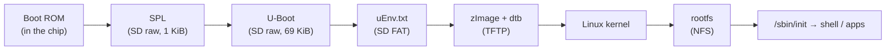

# 00 - The Boot Process

**Goal:** understand every stage between power-on and a Linux shell on the UDOO Quad.

---

## The boot chain



| Stage | Runs from | Main job |
|---|---|---|
| **Boot ROM** | ROM inside the i.MX6 | Read SPL from a fixed offset on the SD card into internal RAM |
| **SPL** | Internal RAM (OCRAM) | Initialise DDR RAM, then load U-Boot into DDR |
| **U-Boot** | DDR RAM | Drivers for SD, Ethernet, TFTP; load kernel + device tree; pass `bootargs` |
| **Kernel** | DDR RAM | Start drivers, mount the root filesystem, start `/sbin/init` |
| **init** | Root filesystem | Run startup scripts, start a shell and applications |

---

## Why two bootloader stages?

At power-on the **DDR RAM is not usable**. Its controller must first be programmed
with the right timings and size. The only working memory is the on-chip RAM:

| Memory | Address | Size | Usable at power-on? |
|---|---|---|---|
| OCRAM (on-chip) | `0x00900000` | 256 KB | ✅ Yes |
| DDR3 | `0x10000000` | 1 GB | ❌ Not until initialised |

Full U-Boot is too large and complex for OCRAM, so the work is split:

1. **SPL** (~43 KB) fits in OCRAM, initialises DDR. On the UDOO it also detects Dual vs Quad.
2. **U-Boot proper** (~400 KB) is then loaded into DDR, where there is plenty of room.

> **MLO = SPL.** "MLO" (MMC Loader) is TI's name for the same first stage on the BeagleBone.

---

## How the i.MX6 Boot ROM finds SPL

The i.MX6 Boot ROM **cannot read filesystems**. It reads **raw sectors**:

- It looks for an **IVT (Image Vector Table)** header at **offset 1 KiB (0x400)** of the SD card.
- `SPL` is built with that header, so it must be written raw with `dd` at 1 KiB.
- The first 1 KiB is left alone because it holds the partition table (MBR).

This is the biggest difference from the BeagleBone, whose AM335x ROM can read a FAT
partition and simply looks for a file named `MLO`.

---

## SD card layout

```
Offset    0      1 KiB         69 KiB                  4 MiB          204 MiB
          |  MBR  |  SPL  ...   | u-boot.img  ...  (free) |  FAT32 BOOT   |  ext4 ROOTFS ...
          |<--------------- raw area: read by Boot ROM / SPL --->|  partition 1  |  partition 2
```

| Area | Read by | Contents |
|---|---|---|
| Raw area (0 - 4 MiB) | Boot ROM, SPL | SPL, u-boot.img, U-Boot environment |
| Partition 1 - FAT32 | U-Boot | `uEnv.txt` (later: kernel + dtb for standalone boot) |
| Partition 2 - ext4 | Linux | Root filesystem for standalone boot (later) |

Starting partition 1 at **4 MiB** keeps filesystems away from the bootloader.

---

## What the kernel needs from U-Boot

1. The **kernel image** (`zImage`) in RAM
2. The **device tree blob** (`imx6q-udoo.dtb`) in RAM - tells the kernel what hardware exists
3. The **kernel command line** (`bootargs`) - console, where the root filesystem is, network settings

`bootz <kernel_addr> - <fdt_addr>` hands all three to the kernel. The `-` means "no initramfs".

---

## What happens after the kernel starts

1. Kernel initialises drivers listed in the device tree
2. Kernel mounts the root filesystem given by `root=` (here: NFS)
3. Kernel starts **`/sbin/init`** (BusyBox) - the first process, PID 1
4. init reads **`/etc/inittab`** → runs **`/etc/init.d/rcS`** → starts the `S??` services → starts a shell on the console (details: [06-init-system](06-init-system.md))

If step 2 fails you get the classic panic:

```
Kernel panic - not syncing: VFS: Unable to mount root fs on unknown-block(0,0)
```

That panic actually proves stages 1-4 of the boot chain work - only the root filesystem is missing.
